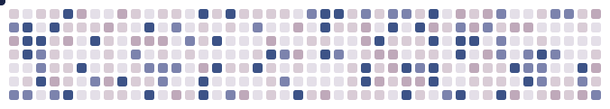
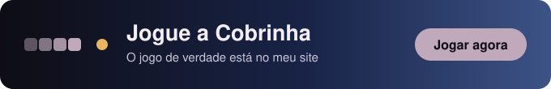

<p align="center">
  
</p>

<p align="center">
  <a href="https://www.linkedin.com/in/filipeaugusto29/"></a>
  
</p>

---

## Sobre mim

Trabalho em operação de SOC: triagem de alertas no **FortiSIEM**, análise de eventos e bloqueio de IPs maliciosos em ambientes de clientes.

Meu próximo passo é o **pentest**. Vir do Blue Team me dá uma vantagem: eu sei como um ataque aparece no log. Por isso meus estudos ofensivos sempre terminam com a pergunta *"como o SOC veria isso?"*.

Gosto de aprender construindo: crio ferramentas, laboratórios e simulações, usando **Python** e desenvolvimento assistido por IA para tirar ideias do papel rápido.

## No dia a dia

- Triagem e análise de alertas no SIEM (FortiSIEM)
- Leitura de logs de firewall (FortiGate)
- Gestão de blocklists e resposta inicial a incidentes

## Estudando agora

- [ ] Pentest web e de infraestrutura (HackTheBox / TryHackMe)
- [ ] Linux e redes com foco ofensivo
- [ ] Python para automação de recon
- [ ] MITRE ATT&CK — do ponto de vista do atacante e do defensor

## Projetos

| Projeto | O que é | Stack |
|---|---|---|
| [**AI Log Generator**](https://github.com/filipe01000/ai-log-generator) | Gera logs sintéticos realistas (FortiGate, Wazuh, Sysmon, Windows, Linux...) para treinar SOC, detecção e CTFs. Mapeia eventos no MITRE ATT&CK e usa IA (OpenAI ou Ollama local) para análise. | TypeScript · Next.js · Ollama |
| [**GuardList**](https://github.com/filipe01000/guardlist) · [abrir](https://guardlist.onrender.com) | Gestão de blocklists por cliente, com importação validada, reputação de IPs, correlação entre clientes, MFA e auditoria. | React, TypeScript, Node.js, PostgreSQL |
| [**Gerenciador de Fraseologias**](https://github.com/filipe01000/fraseologia-manager) | Catálogo de textos padronizados para equipes de suporte, com busca e prévia ao vivo. | Python, Django |
| [**filipeti.com.br**](https://filipeti.com.br) | Meu site de serviços de TI e criação de sites, com tema que acompanha a hora e o clima de Salvador. | HTML, CSS, JavaScript |
| [**Portfólio**](https://cv.filipeti.com.br) | Portfólio interativo em forma de sistema solar, em que cada planeta é um projeto. | HTML, CSS, JavaScript |

> Em breve: ferramentas de recon em Python e writeups de pentest com a visão do SOC em cada máquina.

## Vibe coding

Construo software conversando com agentes de IA, mas sem abrir mão do olhar de segurança. A IA acelera; a responsabilidade pelo resultado continua sendo minha.

- **Da ideia ao deploy:** o GuardList, o SOC AI Log Generator e meus sites foram construídos com desenvolvimento assistido por IA
- **Direção antes do código:** defino o problema, o escopo e o resultado esperado antes de pedir a implementação
- **Revisão com olhar de segurança:** segredos fora do código, validação de entrada, autenticação, MFA e dependências auditadas
- **Nada é aceito sem prova:** testes automatizados, CI e validação no navegador antes de publicar

## Laboratório

Ambiente pessoal para atacar e defender:

`Proxmox` · `pfSense` · `Wazuh` · `Kali Linux` · `Windows Server` · `Linux`

## Stack

```
Segurança   FortiSIEM · FortiGate · Wazuh · MITRE ATT&CK · Kali Linux
Código      Python · TypeScript · Next.js · React · Django
IA          Claude Code · Codex · OpenAI API · Ollama
```

## Certificações

- Microsoft 365 Certified: Modern Desktop Administrator Associate
- Fortinet NSE 1 · NSE 2 · NSE 3

---

<p align="center">
  
</p>

<p align="center">
  <a href="https://filipeti.com.br/jogo.html"></a>
</p>
